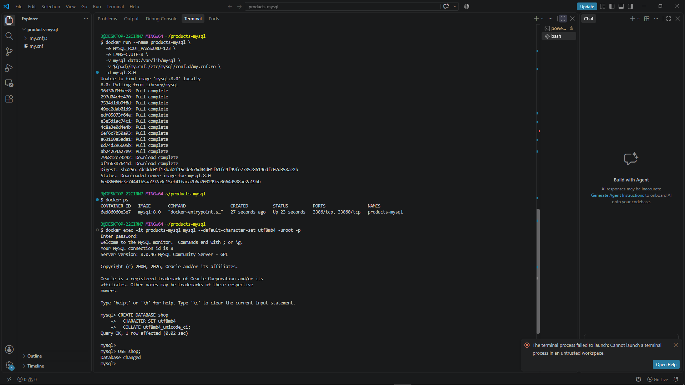
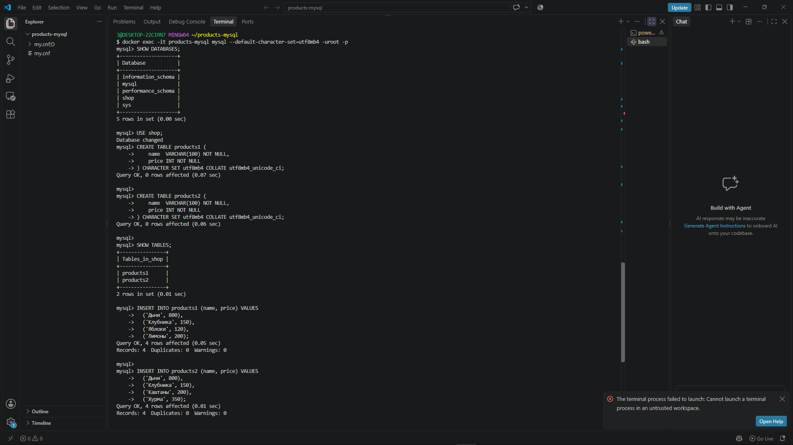
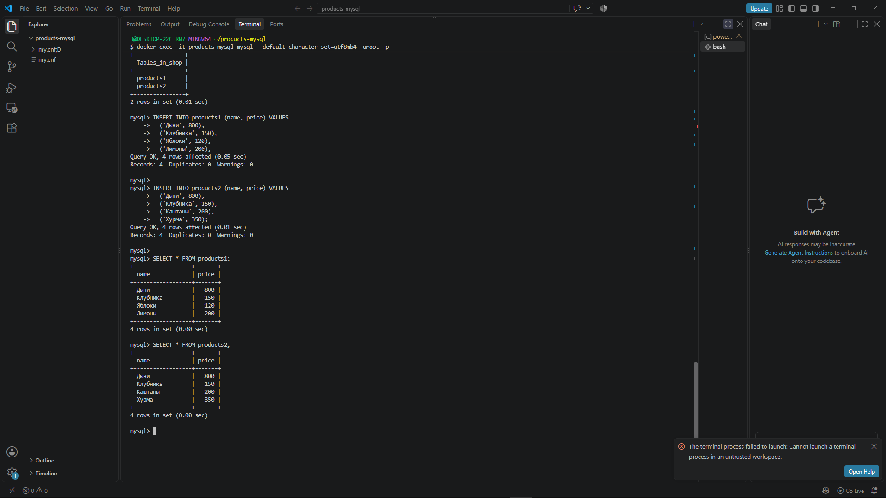
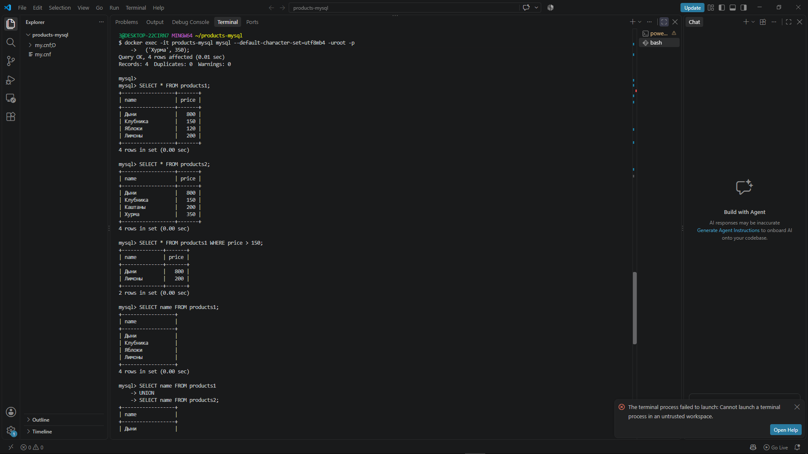
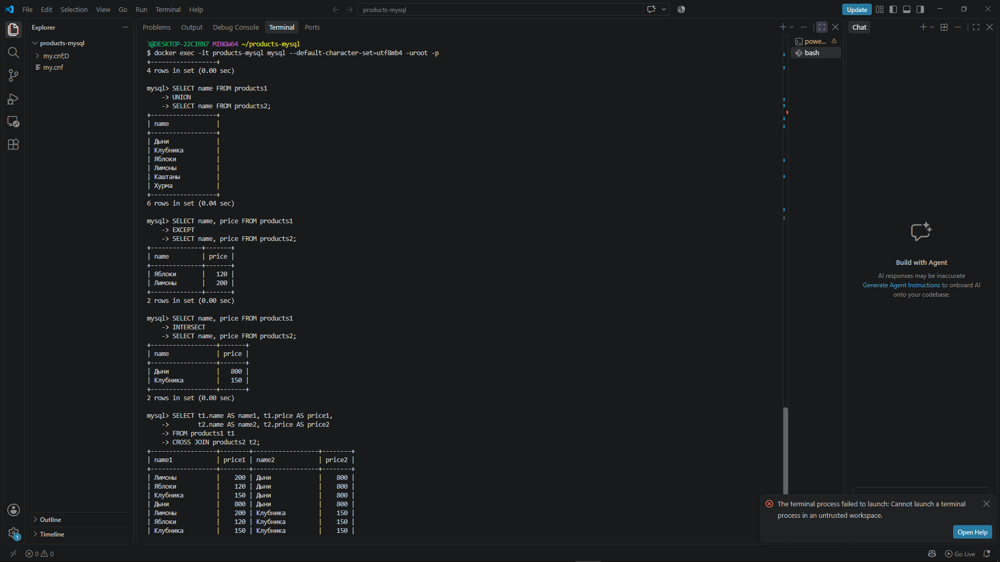
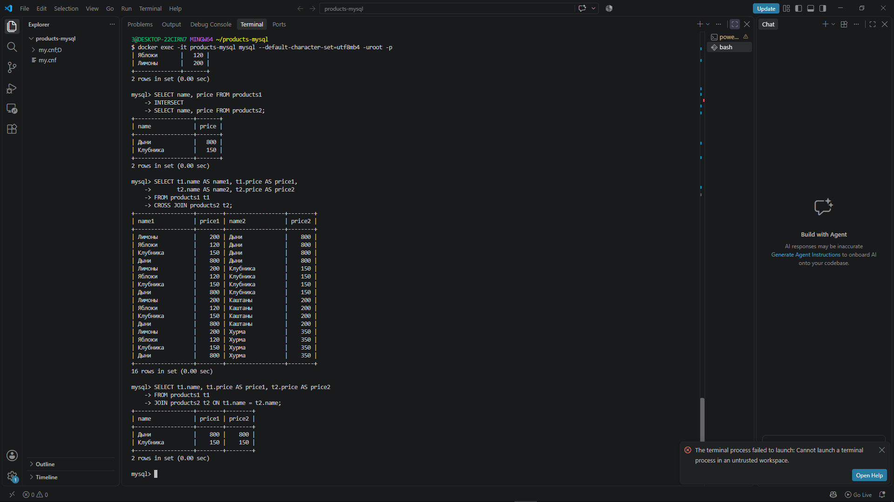
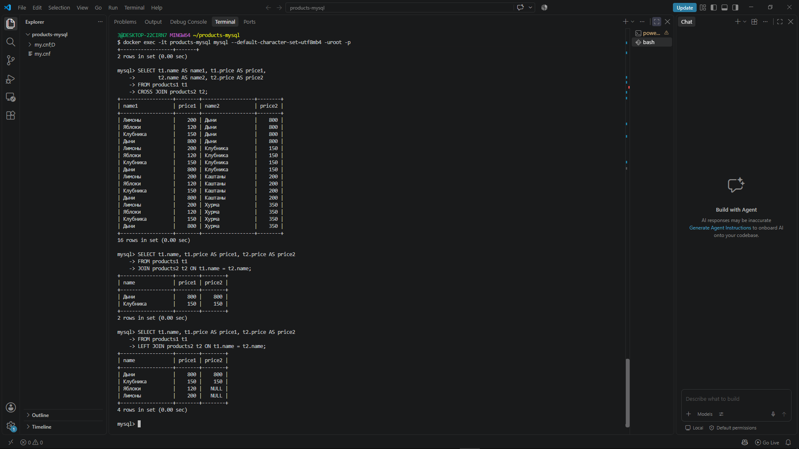

```markdown
# Лабораторная работа: Основные SQL-операции

## Информация о работе

- **Студент:** Котохин Артём Ильич
- **Группа:** [28Ипо8482]
- **Дата выполнения:** 10 ноября 2026
- **Тема:** Основные SQL-операции на примере двух таблиц «products1» и «products2»

---

## 📋 Описание работы

В данной лабораторной работе выполнены основные операции реляционной алгебры на примере двух таблиц с данными о товарах:
- `products1` — первая таблица товаров
- `products2` — вторая таблица товаров

Все операции выполнены в MySQL 8.0, запущенном в Docker-контейнере.

---

## 🛠 Используемые технологии

- **VS Code** — редактор кода
- **Git-Bash** — терминал
- **Docker** — контейнеризация MySQL
- **MySQL 8.0** — система управления базами данных

---

## 📁 Структура проекта

```
products-mysql/
├── my.cnf          # Конфигурация MySQL для UTF-8
├── dump.sql        # Дамп базы данных
├── log.txt         # Лог выполненных команд
├── README.md       # Описание работы
└── screenshots/    # Скриншоты результатов


---

## 🔹 Шаг 1. Создание базы данных

### 1.1. Подготовка Docker-окружения

Очистка предыдущих контейнеров и томов:

```bash
docker ps -a
docker stop products-mysql
docker container prune
docker volume prune -a
```

**Результат:**


### 1.2. Создание конфигурационного файла

Создан файл `my.cnf` для корректного отображения кириллицы:

```ini
[mysqld]
character-set-server = utf8mb4
collation-server = utf8mb4_unicode_ci

[client]
default-character-set = utf8mb4

[mysql]
default-character-set = utf8mb4
```

### 1.3. Запуск MySQL в Docker

```bash
docker run --name products-mysql \
  -e MYSQL_ROOT_PASSWORD=123 \
  -e LANG=C.UTF-8 \
  -v mysql_data:/var/lib/mysql \
  -v $(pwd)/my.cnf:/etc/mysql/conf.d/my.cnf \
  -d mysql:8.0
```

Проверка запуска:

```bash
docker ps
```

**Результат:** Контейнер `products-mysql` запущен со статусом `Up`.

### 1.4. Создание базы данных

Подключение к MySQL:

```bash
docker exec -it products-mysql mysql --default-character-set=utf8mb4 -uroot -p
```

Создание БД:

```sql
CREATE DATABASE shop
  CHARACTER SET utf8mb4
  COLLATE utf8mb4_unicode_ci;

USE shop;

SHOW DATABASES;
```

**Результат:**


---

## 🔹 Шаг 2. Создание таблиц

```sql
CREATE TABLE products1 (
    name  VARCHAR(100) NOT NULL,
    price INT NOT NULL
) CHARACTER SET utf8mb4 COLLATE utf8mb4_unicode_ci;

CREATE TABLE products2 (
    name  VARCHAR(100) NOT NULL,
    price INT NOT NULL
) CHARACTER SET utf8mb4 COLLATE utf8mb4_unicode_ci;

SHOW TABLES;
```

**Результат:**


---

## 🔹 Шаг 3. Вставка данных

```sql
INSERT INTO products1 (name, price) VALUES
  ('Дыни', 800),
  ('Клубника', 150),
  ('Яблоки', 120),
  ('Лимоны', 200);

INSERT INTO products2 (name, price) VALUES
  ('Дыни', 800),
  ('Клубника', 150),
  ('Каштаны', 200),
  ('Хурма', 350);

SELECT * FROM products1;
SELECT * FROM products2;
```

**Результат:**

| products1 | | products2 | |
|-----------|---|-----------|---|
| name | price | name | price |
| Дыни | 800 | Дыни | 800 |
| Клубника | 150 | Клубника | 150 |
| Яблоки | 120 | Каштаны | 200 |
| Лимоны | 200 | Хурма | 350 |


---

## 🔹 Шаг 4. Основные SQL-операции

### 4.1. Выборка (SELECT) — фильтрация строк

**Задача:** показать товары из `products1` дороже 150.

```sql
SELECT * FROM products1 WHERE price > 150;
```

**Результат:**

| name | price |
|------|-------|
| Дыни | 800 |
| Лимоны | 200 |


---

### 4.2. Проекция (PROJECTION) — выбор столбцов

**Задача:** вывести только названия товаров из `products1`.

```sql
SELECT name FROM products1;
```

**Результат:**

| name |
|------|
| Дыни |
| Клубника |
| Яблоки |
| Лимоны |


---

### 4.3. Объединение (UNION)

**Задача:** получить единый список названий товаров из обеих таблиц (без дубликатов).

```sql
SELECT name FROM products1
UNION
SELECT name FROM products2;
```

**Результат:**

| name |
|------|
| Дыни |
| Клубника |
| Яблоки |
| Лимоны |
| Каштаны |
| Хурма |

`UNION` удаляет дубликаты. Для сохранения всех строк используется `UNION ALL`.


---

### 4.4. Разность (EXCEPT)

**Задача:** найти товары, которые есть в `products1`, но отсутствуют в `products2`.

```sql
SELECT name, price FROM products1
EXCEPT
SELECT name, price FROM products2;
```

**Результат:**

| name | price |
|------|-------|
| Яблоки | 120 |
| Лимоны | 200 |


---

### 4.5. Пересечение (INTERSECT)

**Задача:** найти товары, которые есть и в `products1`, и в `products2` (с одинаковой ценой).

```sql
SELECT name, price FROM products1
INTERSECT
SELECT name, price FROM products2;
```

**Результат:**

| name | price |
|------|-------|
| Дыни | 800 |
| Клубника | 150 |


---

### 4.6. Декартово произведение (CROSS JOIN)

**Задача:** получить все возможные пары «товар из первой таблицы — товар из второй».

```sql
SELECT t1.name AS name1, t1.price AS price1,
       t2.name AS name2, t2.price AS price2
FROM products1 t1
CROSS JOIN products2 t2;
```

**Результат:** 4 × 4 = **16 строк** (фрагмент):

| name1 | price1 | name2 | price2 |
|-------|--------|-------|--------|
| Дыни | 800 | Дыни | 800 |
| Дыни | 800 | Клубника | 150 |
| Дыни | 800 | Каштаны | 200 |
| Дыни | 800 | Хурма | 350 |
| Клубника | 150 | Дыни | 800 |
| ... | ... | ... | ... |


---

### 4.7. Соединение (JOIN)

**Задача:** соединить таблицы по названию товара и показать цены из обеих таблиц.

```sql
SELECT t1.name, t1.price AS price1, t2.price AS price2
FROM products1 t1
JOIN products2 t2 ON t1.name = t2.name;
```

**Результат:**

| name | price1 | price2 |
|------|--------|--------|
| Дыни | 800 | 800 |
| Клубника | 150 | 150 |

`JOIN` (INNER JOIN) возвращает только совпадающие строки.


---

### 4.8. Левое соединение (LEFT JOIN)

**Задача:** показать все товары из первой таблицы, даже без пары во второй.

```sql
SELECT t1.name, t1.price AS price1, t2.price AS price2
FROM products1 t1
LEFT JOIN products2 t2 ON t1.name = t2.name;
```

**Результат:**

| name | price1 | price2 |
|------|--------|--------|
| Дыни | 800 | 800 |
| Клубника | 150 | 150 |
| Яблоки | 120 | NULL |
| Лимоны | 200 | NULL |


---

## 🔹 Шаг 5. Создание дампа

Экспорт базы данных в файл:

```bash
\q
docker exec -e MYSQL_PWD=123 products-mysql mysqldump -uroot shop > dump.sql
cat dump.sql
```

**Результат:** Создан файл `dump.sql` с полной структурой и данными БД.


---

## 🔹 Шаг 6. Удаление базы данных

```sql
SHOW DATABASES;
USE shop;
SHOW TABLES;

DROP DATABASE shop;

SHOW DATABASES;
```

**Результат:** База данных `shop` удалена.

---

## 🔹 Шаг 7. Восстановление БД из дампа

Создание пустой БД:

```sql
CREATE DATABASE shop
  CHARACTER SET utf8mb4
  COLLATE utf8mb4_unicode_ci;
```

Импорт из дампа:

```bash
docker exec -i products-mysql mysql -uroot -p123 --force shop < dump.sql
```

Проверка восстановления:

```sql
SHOW DATABASES;
USE shop;
SHOW TABLES;
SELECT * FROM products1;
SELECT * FROM products2;
```

**Результат:** База данных полностью восстановлена из дампа.


---

## 📌 Итоговая таблица операций

| Операция | SQL | Что делает |
|----------|-----|------------|
| Выборка | `WHERE` | Фильтр строк по условию |
| Проекция | `SELECT name` | Выбор определённых столбцов |
| Объединение | `UNION` | Все уникальные строки из двух таблиц |
| Разность | `EXCEPT` | Строки первой таблицы, которых нет во второй |
| Пересечение | `INTERSECT` | Общие строки в обеих таблицах |
| Декартово произведение | `CROSS JOIN` | Все возможные комбинации строк |
| Соединение | `JOIN` | Совпадающие строки по ключу |
| Левое соединение | `LEFT JOIN` | Все строки из левой таблицы + совпадения из правой |

---

## 🧰 Полезные команды MySQL

| Команда | Что делает |
|---------|------------|
| `SHOW DATABASES;` | Список баз данных |
| `USE имя_базы;` | Переключиться на базу |
| `SHOW TABLES;` | Список таблиц в текущей базе |
| `DESCRIBE имя_таблицы;` | Структура таблицы |
| `SHOW CREATE TABLE имя_таблицы;` | SQL для создания таблицы |
| `EXIT;` или `\q` | Выйти из MySQL |
| `\G` вместо `;` | Вертикальный вывод строки |

---

## 📊 Выводы

В ходе выполнения лабораторной работы:

1. ✅ Освоены основные операции реляционной алгебры в SQL
2. ✅ Научился работать с MySQL в Docker-контейнере
3. ✅ Выполнены операции: выборка, проекция, объединение, разность, пересечение, декартово произведение, соединение
4. ✅ Создан дамп базы данных и восстановлен из него
5. ✅ Освоены команды Docker для управления контейнерами

---

## 📎 Файлы проекта

- **my.cnf** — конфигурация MySQL для корректной работы с UTF-8
- **dump.sql** — дамп базы данных (резервная копия)
- **log.txt** — лог выполненных команд
- **README.md** — описание лабораторной работы
- **screenshots/** — скриншоты результатов выполнения







